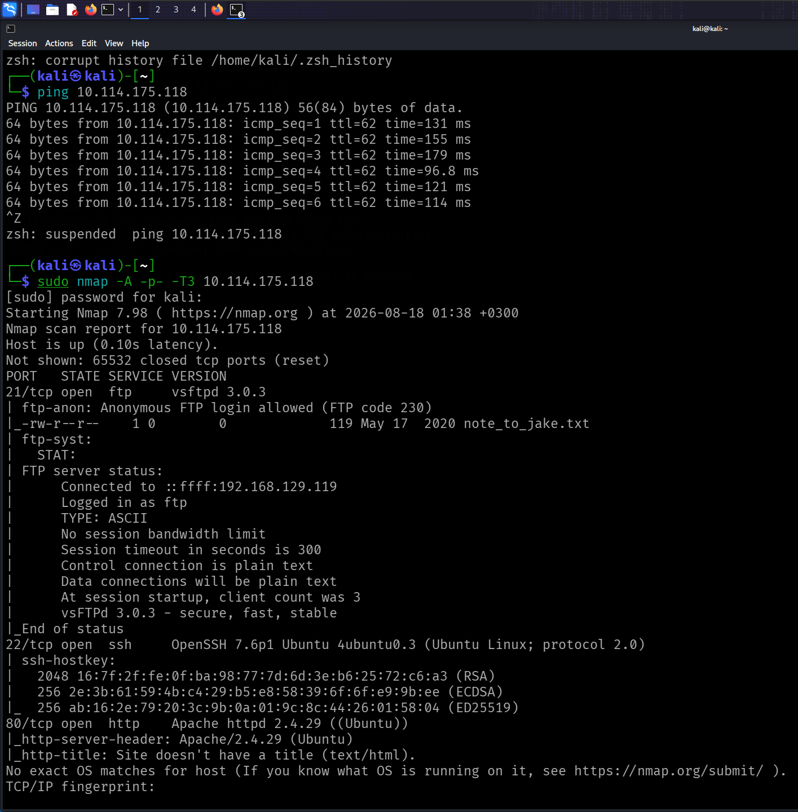

# Reconnaissance

## Overview

Reconnaissance is the first phase of the assessment. The goal is to confirm the target host is reachable and identify open ports and running services so that enumeration can be scoped correctly.

## Objectives

- Confirm the target host (`10.114.175.118`) is alive
- Identify all open TCP ports across the full port range
- Fingerprint the services and versions running on each open port

## Important Terminology

| Term | Definition |
|---|---|
| Host discovery | Determining whether a target is online and responding |
| Port scanning | Probing a target for open network ports |
| Service/version detection | Identifying the software and version listening on a port |
| TTL (Time To Live) | Can hint at the target's OS or network distance |

## Concepts Explained

Before targeting any specific service, standard practice is to verify connectivity, then run a full-range port scan with service and version detection enabled. Scanning all 65,535 ports (`-p-`) avoids missing services running on non-standard ports.

## Commands and Syntax

### Host Discovery

```bash
ping 10.114.175.118
```

### Full Port Scan with Service and Version Detection

```bash
sudo nmap -A -p- -T3 10.114.175.118
```

## Command Breakdown

| Command / Flag | Purpose |
|---|---|
| `ping <ip>` | Confirms the host is up and measures round-trip latency |
| `nmap` | Network scanning utility |
| `-A` | Enables OS detection, version detection, script scanning, and traceroute |
| `-p-` | Scans all 65,535 TCP ports instead of only the top 1,000 |
| `-T3` | Sets the timing template to "Normal" (balanced speed and accuracy) |
| `sudo` | Required for certain scan types and OS fingerprinting |

## Examples

### Ping Sweep

```text
PING 10.114.175.118 (10.114.175.118) 56(84) bytes of data.
64 bytes from 10.114.175.118: icmp_seq=1 ttl=62 time=131 ms
64 bytes from 10.114.175.118: icmp_seq=2 ttl=62 time=155 ms
64 bytes from 10.114.175.118: icmp_seq=3 ttl=62 time=179 ms
64 bytes from 10.114.175.118: icmp_seq=4 ttl=62 time=96.8 ms
64 bytes from 10.114.175.118: icmp_seq=5 ttl=62 time=121 ms
64 bytes from 10.114.175.118: icmp_seq=6 ttl=62 time=114 ms
```

The host responded, confirming it is reachable before proceeding to the port scan.

### Full Nmap Scan

```text
sudo nmap -A -p- -T3 10.114.175.118
Starting Nmap 7.98 ( https://nmap.org ) at 2026-08-18 01:38 +0300
Nmap scan report for 10.114.175.118
Host is up (0.10s latency).
Not shown: 65532 closed tcp ports (reset)
PORT   STATE SERVICE VERSION
21/tcp open  ftp     vsftpd 3.0.3
| ftp-anon: Anonymous FTP login allowed (FTP code 230)
|_-rw-r--r--    1 0        0             119 May 17  2020 note_to_jake.txt
| ftp-syst:
|   STAT:
| FTP server status:
|      Connected to ::ffff:192.168.129.119
|      Logged in as ftp
|      TYPE: ASCII
|      No session bandwidth limit
|      Session timeout in seconds is 300
|      Control connection is plain text
|      Data connections will be plain text
|      At session startup, client count was 3
|      vsFTPd 3.0.3 - secure, fast, stable
|_End of status
22/tcp open  ssh     OpenSSH 7.6p1 Ubuntu 4ubuntu0.3 (Ubuntu Linux; protocol 2.0)
| ssh-hostkey:
|   2048 16:7f:2f:fe:0f:ba:98:77:7d:6d:3e:b6:25:72:c6:a3 (RSA)
|   256 2e:3b:61:59:4b:c4:29:b5:e8:58:39:6f:6f:e9:9b:ee (ECDSA)
|_  256 ab:16:2e:79:20:3c:9b:0a:01:9c:8c:44:26:01:58:04 (ED25519)
80/tcp open  http    Apache httpd 2.4.29 ((Ubuntu))
|_http-server-header: Apache/2.4.29 (Ubuntu)
|_http-title: Site doesn't have a title (text/html).
No exact OS matches for host (If you know what OS is running on it, see https://nmap.org/submit/ ).
```

## Screenshots


*Full-port Nmap scan showing three open services: FTP (21), SSH (22), and HTTP (80), including the `ftp-anon` script confirming anonymous FTP access.*

## Observations

| Port | Service | Version | Notes |
|---|---|---|---|
| 21/tcp | FTP | vsftpd 3.0.3 | Anonymous login allowed; a file `note_to_jake.txt` is visible in the listing |
| 22/tcp | SSH | OpenSSH 7.6p1 (Ubuntu 4ubuntu0.3) | Standard SSH service, protocol 2.0 |
| 80/tcp | HTTP | Apache httpd 2.4.29 (Ubuntu) | Web server present, no page title returned |

> [!IMPORTANT]
> The `ftp-anon` NSE script, run automatically as part of `-A`, immediately flagged anonymous FTP access along with a visible file. This is a strong early lead that directly shapes the next phase of enumeration.

## Common Mistakes

- Scanning only the default top 1,000 ports and missing services on non-standard ports
- Skipping host discovery before running a lengthy full-port scan
- Overlooking NSE script output bundled into `-A`, which can reveal quick wins

## Notes

- The `ftp-anon` output was returned automatically as part of `-A`; no separate anonymous-login check was required at this stage.
- Three open ports were identified: FTP (21), SSH (22), and HTTP (80).

## Additional Context

> [!NOTE]
> The following is supplementary information, not derived from the lab notes.

`-T3` is Nmap's default timing template; specifying it explicitly makes the timing choice intentional rather than implicit. In time-constrained environments, `-T4` is commonly used for faster scans at the cost of being noisier and more detectable. For large scopes, running a fast port sweep first and then a targeted `-A` scan against only the discovered open ports is a common optimization, though unnecessary for a single host.

## References

- [Nmap Reference Guide](https://nmap.org/book/man.html)
- [Nmap NSE: ftp-anon](https://nmap.org/nsedoc/scripts/ftp-anon.html)

## Key Takeaways

- Always confirm host liveness before scanning.
- A full-range, version-aware scan (`-A -p-`) surfaces both the attack surface and immediate leads, such as anonymous FTP with a readable file.
- Three services were identified — FTP (21), SSH (22), and HTTP (80) — each explored in the following sections.
