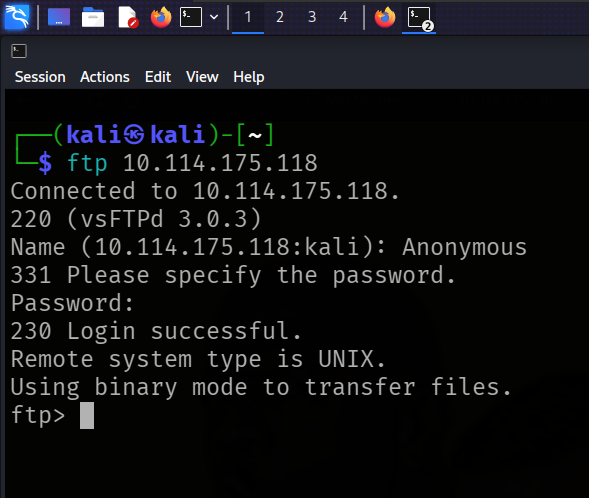
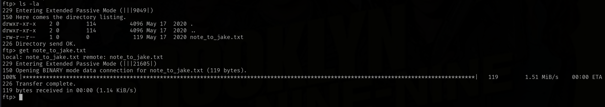

# FTP Enumeration

## Overview

The Nmap scan confirmed anonymous FTP login was allowed on port 21 (vsftpd 3.0.3), with a file, `note_to_jake.txt`, already visible in the directory listing. This section documents connecting to the FTP service, listing its contents, and retrieving the file.

## Objectives

- Connect to the FTP service using anonymous credentials
- List the contents of the FTP root directory
- Download any accessible files for offline review

## Important Terminology

| Term | Definition |
|---|---|
| Anonymous FTP | An FTP configuration that allows login with the username `anonymous` and any (often blank) password |
| Passive mode | An FTP data transfer mode where the client initiates both the control and data connections |
| `get` | The FTP client command used to download a file from the server |

## Concepts Explained

Since Nmap's `ftp-anon` script already confirmed anonymous access, the next step is to manually connect using the standard `ftp` client, confirm the same access interactively, and retrieve any available files.

## Commands and Syntax

### Connect to the FTP Service

```bash
ftp 10.114.175.118
```

### List Directory Contents

```text
ls -la
```

### Download a File

```text
get note_to_jake.txt
```

## Command Breakdown

| Command | Purpose |
|---|---|
| `ftp <ip>` | Opens an interactive FTP session to the target |
| `Anonymous` (as username) | Authenticates using the anonymous account |
| `ls -la` | Lists all files and directories, including hidden ones, in the current remote directory |
| `get <filename>` | Downloads the specified file to the local working directory |

## Examples

### Connecting Anonymously

```text
$ ftp 10.114.175.118
Connected to 10.114.175.118.
220 (vsFTPd 3.0.3)
Name (10.114.175.118:kali): Anonymous
331 Please specify the password.
Password:
230 Login successful.
Remote system type is UNIX.
Using binary mode to transfer files.
ftp>
```

### Listing and Downloading the File

```text
ftp> ls -la
229 Entering Extended Passive Mode (|||9049|)
150 Here comes the directory listing.
drwxr-xr-x    2 0        114          4096 May 17  2020 .
drwxr-xr-x    2 0        114          4096 May 17  2020 ..
-rw-r--r--    1 0        0             119 May 17  2020 note_to_jake.txt
226 Directory send OK.
ftp> get note_to_jake.txt
local: note_to_jake.txt remote: note_to_jake.txt
229 Entering Extended Passive Mode (|||21605|)
150 Opening BINARY mode data connection for note_to_jake.txt (119 bytes).
100% |*****************************************************************|   119      1.51 MiB/s    00:00 ETA
226 Transfer complete.
119 bytes received in 00:00 (1.14 KiB/s)
ftp>
```

## Screenshots


*Successful anonymous authentication to the FTP service.*


*Directory listing and successful download of `note_to_jake.txt`.*

## Observations

- The FTP server accepted the login `Anonymous` with a blank password, confirming the Nmap `ftp-anon` finding.
- A single file, `note_to_jake.txt` (119 bytes, owned by uid 0 / gid 0), was present in the root directory.
- The file was successfully downloaded for offline analysis; see [05 – Credentials](../05-Credentials/README.md).

## Common Mistakes

- Assuming anonymous FTP requires no password at all — most clients still require pressing Enter at a blank password prompt.
- Not switching to binary mode before downloading non-text files, which can corrupt the transfer.
- Overlooking file ownership and permissions in the `ls -la` output, which can hint at how a file was placed there.

## Notes

- File ownership (`0 0`) indicates the file is owned by `root`, though this alone does not indicate how it was created or last modified.
- The filename itself, `note_to_jake.txt`, was already a strong indicator of a relevant username (`jake`) before the file was even opened.

## Additional Context

> [!NOTE]
> The following is supplementary information, not derived from the lab notes.

Anonymous FTP write access, when present, can sometimes be abused to upload a web shell if the FTP root overlaps with a web root. This was not applicable here, since only read access was demonstrated.

## References

- [vsftpd Documentation](https://security.appspot.com/vsftpd.html)
- [Nmap ftp-anon NSE Script](https://nmap.org/nsedoc/scripts/ftp-anon.html)

## Key Takeaways

- Anonymous FTP access, when available, is a fast and low-effort way to gather information before attempting credentialed attacks.
- The retrieved file, `note_to_jake.txt`, became the pivot point into the credential discovery phase.
