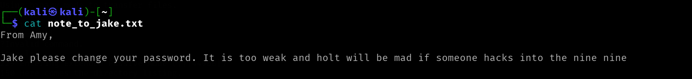
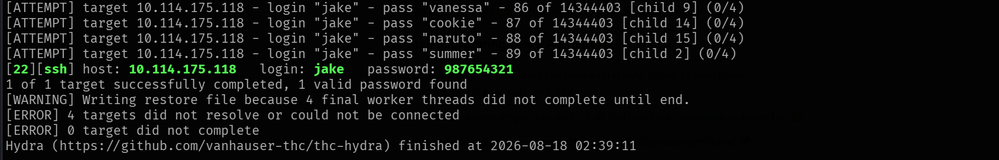

# Credential Discovery

## Overview

This section documents reviewing the file retrieved from the FTP server and using the information it contained to run a targeted password brute-force attack against SSH with Hydra.

## Objectives

- Review the contents of the downloaded `note_to_jake.txt` file
- Identify a candidate username for further attacks
- Run an online password brute-force attack against SSH using Hydra
- Recover a valid set of credentials

## Important Terminology

| Term | Definition |
|---|---|
| Online brute force | Attempting many password guesses directly against a live authentication service |
| Wordlist | A file containing candidate passwords used during a brute-force attack |
| Hydra | A parallelized login cracker supporting many protocols, including SSH |

## Concepts Explained

The note file downloaded from FTP referenced a specific user, `jake`, and indicated that his password was weak. This directly informed the decision to run a targeted Hydra brute-force attack against SSH using the username `jake`.

## Commands and Syntax

### Reading the Note File

```bash
cat note_to_jake.txt
```

### Brute Forcing SSH with Hydra

```bash
hydra -l jake -P <wordlist> ssh://10.114.175.118
```

> [!NOTE]
> The exact wordlist path used was not captured in the lab notes. The Hydra output shows a run against a large wordlist (14,344,403 candidate passwords).

## Command Breakdown

| Component | Purpose |
|---|---|
| `-l jake` | Specifies a single, known username to test, rather than a username list |
| `-P <wordlist>` | Specifies the password wordlist to iterate through |
| `ssh://10.114.175.118` | Specifies the target protocol and IP address |

## Examples

### Note File Contents

```text
$ cat note_to_jake.txt
From Amy,

Jake please change your password. It is too weak and holt will be mad if someone hacks into the nine nine
```

### Hydra Brute Force Output

```text
[ATTEMPT] target 10.114.175.118 - login "jake" - pass "vanessa" - 86 of 14344403 [child 9] (0/4)
[ATTEMPT] target 10.114.175.118 - login "jake" - pass "cookie" - 87 of 14344403 [child 14] (0/4)
[ATTEMPT] target 10.114.175.118 - login "jake" - pass "naruto" - 88 of 14344403 [child 15] (0/4)
[ATTEMPT] target 10.114.175.118 - login "jake" - pass "summer" - 89 of 14344403 [child 2] (0/4)
[22][ssh] host: 10.114.175.118   login: jake   password: 987654321
1 of 1 target successfully completed, 1 valid password found
[WARNING] Writing restore file because 4 final worker threads did not complete until end.
[ERROR] 4 targets did not resolve or could not be connected
[ERROR] 0 target did not complete
Hydra (https://github.com/vanhauser-thc/thc-hydra) finished at 2026-08-18 02:39:11
```

## Screenshots


*Contents of the note retrieved from the FTP server, referencing the user `jake` and a weak password.*


*Hydra recovering valid SSH credentials for the user `jake`.*

## Observations

| Finding | Detail |
|---|---|
| Author of note | Amy |
| Referenced user | Jake |
| Reason for note | Warning that Jake's password is weak |
| Recovered credentials | `jake` : `987654321` |
| Target service | SSH (port 22) |

> [!WARNING]
> The recovered password, `987654321`, is a sequential numeric pattern, a textbook example of a weak, easily guessed password, directly matching the warning in the note itself.

## Common Mistakes

- Running a full username-and-password brute force (`-L` and `-P`) instead of narrowing to a known username (`-l jake`), unnecessarily increasing attack time.
- Ignoring in-band hints, such as a note explicitly stating a password is weak, and defaulting to a purely random wordlist strategy.
- Not respecting target rate limits or lockout policies when brute forcing authentication services in real-world engagements.

## Notes

- The note file provided both a confirmed username (`jake`) and a behavioral hint (weak password), making the Hydra attack far more targeted than a blind brute force.
- The recovered credentials were used directly in the next phase to establish SSH access.

## Additional Context

> [!NOTE]
> The following is supplementary information, not derived from the lab notes.

In real-world engagements, online brute-force attacks against authentication services should always be scoped and rate-limited per the rules of engagement to avoid account lockouts or denial-of-service conditions.

## References

- [THC-Hydra GitHub Repository](https://github.com/vanhauser-thc/thc-hydra)

## Key Takeaways

- A seemingly minor, exposed text file directly led to valid SSH credentials.
- Contextual clues, such as a note warning about a weak password, can meaningfully narrow the scope of a brute-force attack.
- Recovered credentials: `jake` / `987654321`.
