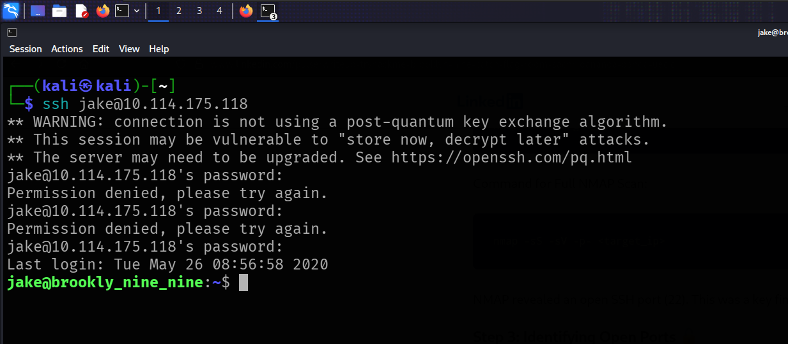

# Initial Access

## Overview

With valid credentials (`jake` / `987654321`) recovered via Hydra, this section documents using them to authenticate over SSH and establish an initial foothold on the target.

## Objectives

- Authenticate to the target over SSH using the recovered credentials
- Confirm shell access as the `jake` user
- Prepare for local enumeration and privilege escalation

## Important Terminology

| Term | Definition |
|---|---|
| Foothold | The first level of interactive access gained on a target system |
| Post-quantum key exchange | A newer SSH key exchange method designed to resist future quantum-computing attacks; its absence is flagged as a warning by modern SSH clients |

## Concepts Explained

SSH is a standard remote administration protocol. Since valid credentials were already recovered, authentication was performed directly rather than through additional exploitation.

## Commands and Syntax

```bash
ssh jake@10.114.175.118
```

## Command Breakdown

| Component | Purpose |
|---|---|
| `ssh` | Invokes the SSH client |
| `jake@10.114.175.118` | Specifies the username and target host to connect to |
| Password prompt | The recovered password (`987654321`) was entered when prompted |

## Examples

```text
$ ssh jake@10.114.175.118
** WARNING: connection is not using a post-quantum key exchange algorithm.
** This session may be vulnerable to "store now, decrypt later" attacks.
** The server may need to be upgraded. See https://openssh.com/pq.html
jake@10.114.175.118's password:
Permission denied, please try again.
jake@10.114.175.118's password:
Permission denied, please try again.
jake@10.114.175.118's password:
Last login: Tue May 26 08:56:58 2020
jake@brookly_nine_nine:~$
```

## Screenshots


*Successful SSH login as `jake` after two failed attempts.*

## Observations

- The first two password attempts failed (`Permission denied, please try again`) before a successful login on the third attempt.
- The shell prompt confirms the hostname `brookly_nine_nine`, consistent with the Brooklyn Nine-Nine theming observed on the web page and in the FTP note.
- The client displayed a warning about the session not using a post-quantum key exchange algorithm. This is an informational client-side advisory, not an indication of a vulnerability that was exploited.

## Common Mistakes

- Assuming a failed password attempt means the credentials are invalid — retrying is worthwhile if the credential source is already confirmed, as it was here via Hydra.
- Not confirming the current user context (`whoami`, prompt inspection) immediately after gaining a shell.

## Notes

- Access was gained as the unprivileged user `jake`, not `root`.
- This shell became the base for local enumeration in the [Privilege Escalation](../07-Privilege-Escalation/README.md) phase.

## Additional Context

> [!NOTE]
> The following is supplementary information, not derived from the lab notes.

The post-quantum key exchange warning shown by the SSH client is a general advisory related to long-term cryptographic security and is unrelated to the credential-based access method used here.

## References

- [OpenSSH Manual](https://www.openssh.com/manual.html)

## Key Takeaways

- Valid credentials recovered from a prior brute-force attack were sufficient to establish a full interactive shell over SSH.
- Initial access was obtained as the low-privileged user `jake`, setting up the need for privilege escalation.
